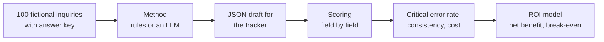

# Which LLM Should an Export Sales Team Use, and Is It Worth It?

**English** · [中文](README.zh-CN.md) · [Interactive ROI calculator](https://hql7-luo.github.io/llm-selection-roi/) · [Methodology](docs/methodology.md)

A small Chinese exporter of printing consumables and packaging gets about 500 inquiries a month by email, Alibaba and chat. Today a salesperson reads each one, types the details into a tracker and decides which to answer first. The idea: let an LLM draft the tracker entry (product, spec, quantity, target price, Incoterm, destination, delivery date, missing information, priority) and have the salesperson check it.

Two questions: **which model should the team use, and is it worth paying for at all?** This project uses 100 labeled inquiries, a scoring script, a no-AI baseline, three tested Claude models, two GPT models tested in Codex, API reference prices, public leaderboard scores and a simple ROI model. The company and every inquiry are fictional.

## The answer

**Claude Haiku 5.5 combines a low API reference price with no observed critical errors on this dataset. Validate that choice on your own inquiries.** Under the base-case assumptions, AI-assisted handling breaks even at about **17% critical errors**. All five tested models were below that line; the rules baseline was above it. This is a modeled result, not measured business savings.

- **Errors differed across models.** Each model answered the same 80 inquiries twice. Haiku and Opus had no critical errors; Sonnet had **1/160 (0.63%)**, GPT-6.1 Sol had **2/160 (1.25%)**, and GPT-6 Luna had **11/160 (6.88%)**. Rules had critical errors on **20%** of inquiries, including **55%** of the hard ones. Sol's normalized outputs matched across both runs despite its errors. Consistency alone does not establish correctness.
- **The ROI depends on the assumptions.** At 500 inquiries a month, Haiku's modeled net benefit is about **$714 a month**, with **2.8 months** to recover setup cost. The corresponding estimates are **$660 and 3.0 months** for Sol, and **$425 and 4.7 months** for Luna. Rules alone have a modeled loss of about **$125 a month**.
- **Error costs matter more than token prices in this model.** Estimated API reference cost ranges from **$0.04 to $6.18 per 1,000 inquiries**, against about **$728 of potential labor savings**. Each percentage point of critical errors costs about **$42 a month**, while the largest price gap is about **$3 a month**. Luna has the same reference token price as Haiku but more errors here. Opus costs more than Haiku without improving its score; Sol also costs more and made errors. Higher price did not ensure higher accuracy.
- **Public scores and synthetic tests are limited evidence.** Artificial Analysis is a general reasoning composite, not an inquiry extraction test. The GPT entries below use medium reasoning; the retained Claude entries use their highest listed settings. The inquiries and answer key were written with Claude's help, which may favor Claude. Confirm the result with anonymized real inquiries before adopting a model.


## Model results

Measured methods used the same 80 test inquiries and extraction instructions. Agent system prompts and runtime settings differ. Values below come from [`results/method_summary.csv`](results/method_summary.csv).

| Method | Tested how | API reference cost per 1,000 | Critical error rate | Fields correct | Output consistency | Score consistency | Public index (AA) |
|---|---|---:|---:|---:|---:|---:|---:|
| Rules baseline (no AI) | run locally | $0 | **20.00%** | 93.01% | (1 run) | (1 run) | |
| Claude Haiku 5.5 | Claude subagent, 2 runs | $0.15 (est.) | **0.00%** | 100.00% | 95.00% | 100.00% | 43 |
| Claude Sonnet 5.5 | Claude subagent, 2 runs | $3.09 (est.) | **0.63%** | 99.70% | 95.00% | 97.50% | 56 |
| Claude Opus 5.5 | Claude subagent, 2 runs | $6.18 (est.) | **0.00%** | 100.00% | 95.00% | 100.00% | 58 |
| GPT-6.1 Sol | Codex, 2 runs, medium | $3.09 (est.) | **1.25%** | 99.55% | 100.00% | 100.00% | 48 |
| GPT-6 Luna | Codex, 2 runs, medium | $0.15 (est.) | **6.88%** | 97.84% | 78.75% | 82.50% | 30 |
| DeepSeek V4.1 Flash | not tested | $0.42 (est.) | | | | | 45 |
| Qwen3.7 Flash | not tested | $0.04 (est.) | | | | | not listed |
| Qwen3.5 Plus | not tested | $0.68 (est.) | | | | | not listed |

**Consistency definitions.** Output consistency compares normalized extracted outputs across runs, excluding priority explanations. Score consistency compares the field-level correct/incorrect pattern against the answer key. Different outputs can receive the same scores. Rates are rounded from the summary file; the error counts above give the exact denominators.

The GPT results use `codex__gpt-6.1-sol` and `codex__gpt-6-luna`. The separate `openai__` methods remain pending API tests and are omitted from this table. Their older max-setting public scores remain in the source data. The Codex rows use AA Intelligence Index v4.3.2 at medium reasoning, so public scores in this table do not share a common reasoning setting.


**How the Claude models were tested.** No API key was used. The three models ran as Claude subagents in the build environment: each got a batch of 20 inquiries with the same instructions as the API prompt, was allowed to open only that one batch file (each made a single file read), and replied with one JSON answer per inquiry. Each model did the 80 test inquiries twice. Raw replies are kept in [`runs/`](runs). Because there was no API call, there are no token counts or response times; cost is estimated from list prices.

**How the GPT models were tested.** No API key was used. The configured default model, GPT-6.1 Sol, and the smaller GPT-6 Luna ran at medium reasoning in fresh `codex exec` instances outside this repository. Each model completed two runs of four batches of 20. Every instance used a read-only sandbox, read only its batch file, and wrote its final reply through the CLI's output option. All 16 batches passed the first format check, with 20 JSON answers each; none were rerun or edited. The 16 instances had distinct thread IDs. These are Codex results, not API results, and Codex cost was not measured. The table uses estimated token usage and official API reference prices.

**Models still pending.** DeepSeek and Qwen have not been tested. The `openai__` API methods are also pending; the GPT measurements here are the separate Codex methods. Use the [API runner](#re-run-through-the-api) to collect API results and actual token usage.

**The Claude error.** Sonnet once filled in "thermal" as the spec for a Russian inquiry that names "термальные пластины CTP" (thermal CTP plates) but gives no size or thickness. The answer key says no spec, since a plate cannot be quoted without size and thickness; Sonnet's reading is defensible. On the second run it agreed with the key.

## Key charts

**Cost.** The highest estimated API reference cost is under 1% of the modeled labor savings. This does not measure Codex billing.


**Where rules break.** Rules read tidy forms well. On the test set they failed on quantities in words, cans or "25k", prices per 1,000 pieces, relative dates ("end of next month"), an older offer quoted below the reply, and company names that contain a product word or a city ("Minsk Label House").


**What moves the bar.** The review step, the cost of a mistake and the human error rate matter most. Model price is the smallest bar.


## How it works



- **Dataset:** 60 regular inquiries (Alibaba RFQ forms, short emails, chat messages, 8 in Russian), 25 hard ones written by hand, 15 traps (spam, phishing, fee scams, products we do not sell). 20 for building the prompt and rules, 80 locked for testing.
- **Critical error:** an inquiry with a wrong product, spec, quantity, target price or delivery date, an invented item, or a high-priority lead ranked lower. Also measured: field accuracy, weighted error, invented values, priority confusion matrix, JSON failures and run-to-run consistency.
- **ROI per inquiry:** labor saved minus API cost minus the extra cost of mistakes, compared with a person doing it by hand (people make mistakes too). Monthly maintenance is included; the one-time setup cost gives the payback period.

Details: [methodology](docs/methodology.md).

## Data

| Input | Value | Source (date) |
|---|---|---|
| Claude Haiku / Sonnet / Opus 5.5 | $0.10 / $2 / $4 input, $0.50 / $10 / $20 output per million tokens | Anthropic pricing page (Oct 23, 2026) |
| GPT-6.1 Sol / GPT-6 Luna (`codex__`) | $2 / $0.10 input, $10 / $0.50 output per million tokens | Official OpenAI API pricing (Oct 23, 2026), Standard, up to 272K input tokens; Codex cost not measured |
| Pending `openai__` API methods, DeepSeek V4.1 Flash, Qwen3.7 Flash, Qwen3.5 Plus | see [`data/pricing.csv`](data/pricing.csv) | Original BenchLM price tables citing official pages; secondary references retained |
| Public leaderboard scores | see [`data/public_benchmarks.csv`](data/public_benchmarks.csv) | Artificial Analysis (Oct 23, 2026); Codex entries use medium, v4.3.2; other entries retain highest listed settings |
| Foreign-trade salesperson salary, Hangzhou | ¥8,672 a month | Liepin, 4,443 postings over the past year (checked Oct 23, 2026) |
| USD/CNY | 6.6781 | Oct 22, 2026 |
| Handling time, review time, catch rate, error cost, volume | see [`data/roi_inputs.csv`](data/roi_inputs.csv) | Assumptions, labeled as such, with low and high values |

All sources with links: [docs/data-sources.md](docs/data-sources.md).

## Run it

```bash
pip install -r requirements.txt
python build_dataset.py      # rebuilds data/ (same output every time)
python run_eval.py rules     # no-AI baseline, free
python run_analysis.py       # scores every run, writes results/, figures/ and docs/roi-data.js
pytest                       # checks for data, scoring, rules, runner, ROI and calculator parity
```

### Test a model without an API key

Create batches outside the repository, then use a fresh agent for each batch. The Claude and Codex results use this batch format:

```bash
python batches.py make ~/llm-batches/gpt-6.1-sol/run1
codex exec --cd ~/llm-batches/gpt-6.1-sol/run1 --model gpt-6.1-sol \
  --sandbox read-only --skip-git-repo-check --ignore-user-config --ephemeral \
  -c model_reasoning_effort=medium -c web_search=disabled --json \
  --output-last-message ~/llm-batches/gpt-6.1-sol/run1/reply1.txt \
  'Read batch1.txt in this folder and follow the instructions inside it. Answer every message yourself by reading it. Do not write or run any code, scripts or regex, and do not search the web. Do not open, list or search any other file or folder. Your final reply must be only the MODEL line followed by the ```jsonl block, exactly as batch1.txt asks.'
# Complete batches 2 to 4 with fresh exec commands and check all four replies before importing.
python batches.py import codex__gpt-6.1-sol run1 ~/llm-batches/gpt-6.1-sol/run1 "Codex, batch of 20"
python run_analysis.py
```

Repeat the fresh `codex exec` command for batches 2 to 4, changing both file numbers. Check each reply contains 20 JSON lines starting with `{"id"` before importing. Create and complete a separate `run2` folder, then import it as `run2`. Repeat for `gpt-6-luna`. Keep the answering agents out of this repository so they cannot see `data/gold.jsonl`.

### Re-run through the API

To test a model the normal way (one inquiry per call, temperature 0, real token counts), set its key and run:

```bash
export DEEPSEEK_API_KEY=...             # or ANTHROPIC_API_KEY, OPENAI_API_KEY, DASHSCOPE_API_KEY
python run_eval.py deepseek:deepseek-flash --split dev --runs 1   # quick check on 20 inquiries
python run_eval.py deepseek:deepseek-flash --runs 3               # full run
python run_analysis.py
```

The estimated budget for testing the eight API models three times is about $3.32 at list prices, from [`results/headline.csv`](results/headline.csv). This is not measured spending. For a model not in [`data/pricing.csv`](data/pricing.csv), add a row first. Re-running a Claude model through the API replaces its subagent results; the `openai__` and `codex__` methods are separate.

## Repository

```
data/          inquiries.jsonl, gold.jsonl (answer key), catalog, prices, public scores, ROI inputs, field weights
prompts/       extract_v1.txt (the instructions every model gets)
src/llmroi/    dataset and labels, rules baseline, API runner, subagent batches, scoring, ROI model, charts
batches.py     make batch files for an agent and import its replies (no API key)
runs/          answers per method; runs/<model>/raw/ keeps the subagent replies as received
results/       output tables (CSV)
figures/       charts used in this README
docs/          methodology, data sources, ROI calculator (index.html)
tests/         checks for data, scoring, rules, runner and ROI
```

## Limits

- **The data is synthetic and Claude helped write it.** The inquiries and answer key were written for this project with Claude's help, modeled on common printing-consumables export inquiries. This may favor Claude, and all scores may be optimistic for real inboxes.
- **The sample is small.** There are 80 test inquiries and two runs per model. Repeating the same inquiries does not create 160 independent examples. Zero observed critical errors does not establish a zero error rate in production.
- **Neither the Claude nor the Codex runs were API runs.** Agents handled 20 inquiries at a time. Claude used its agent defaults; both GPT models used medium reasoning in Codex. Agent system prompts, tools and runtime settings differ, and API results may differ. Token usage and API reference costs are estimated; Codex cost was not measured.
- **Coverage remains incomplete.** Two vendors were tested, but DeepSeek, Qwen and the separate OpenAI API methods remain pending. Public scores use different reasoning settings. Mainland access, data privacy and payment also matter for a Chinese exporter and are not scored here.
- **The rules baseline is probably optimistic.** The same author wrote the rules and the data. Real inboxes are messier.
- **Labor and error-cost numbers are assumptions.** The most important ones (catch rate, cost of an escaped error, manual error rate) should be measured: time 10 inquiries by hand, and track how many AI errors reviewers catch in the first month.
- **Prices change.** The new Codex rows use verified official OpenAI API prices as references. Historical `openai__` rows and DeepSeek/Qwen rows retain secondary sources. Re-check prices before reuse.

## About

Independent project by Haoqi Luo (University of Washington, Foster School of Business). I chose the business question from my export sales experience and set the scope; Claude substantially assisted the research, data, code and writing. Codex also assisted this evaluation and documentation update. Not financial advice.
