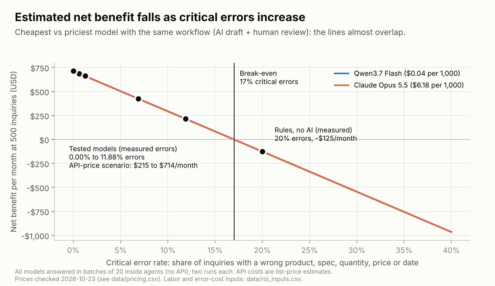
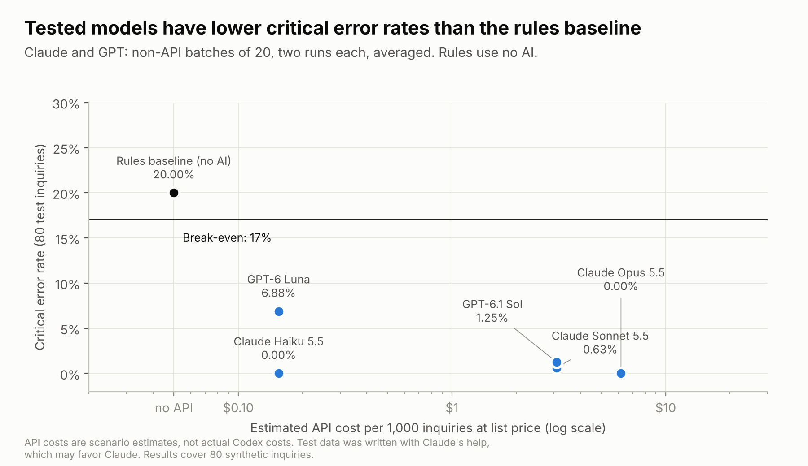
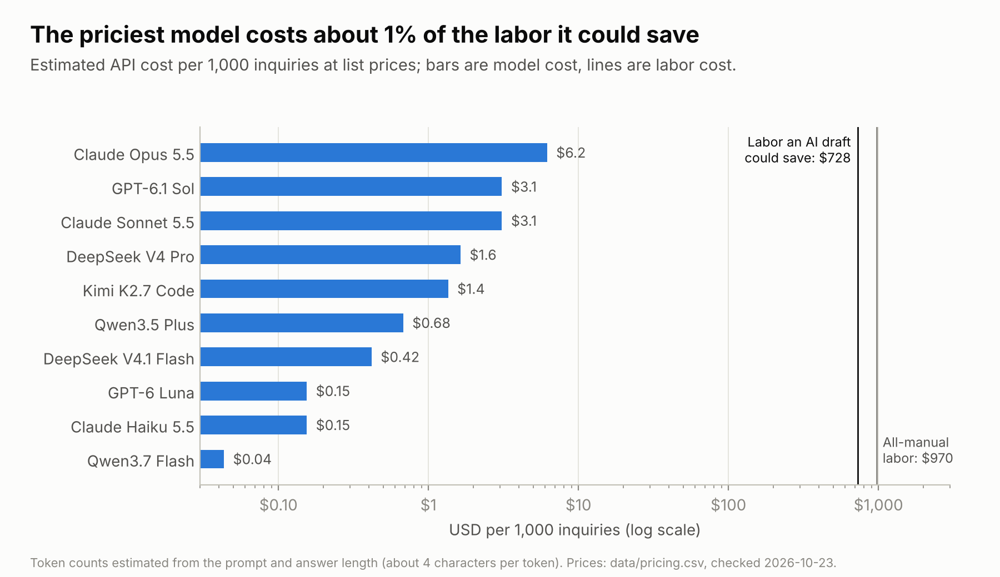
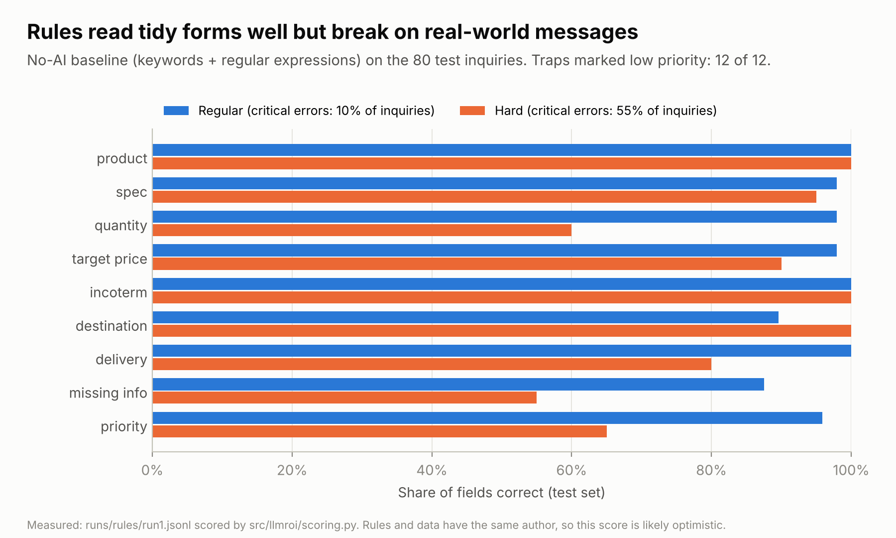
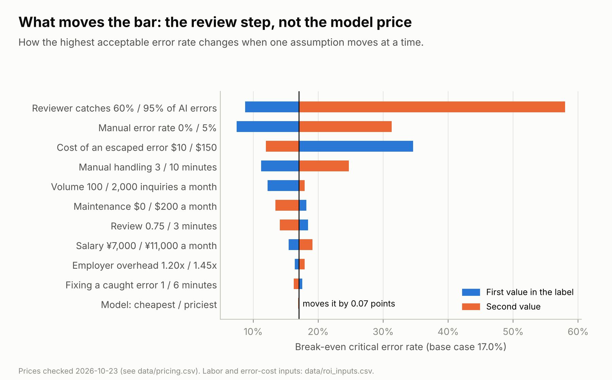
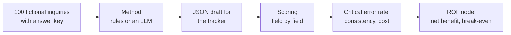

# Which LLM Should an Export Sales Team Use, and Is It Worth It?

**English** · [中文](README.zh-CN.md) · [Interactive ROI calculator](https://hql7-luo.github.io/llm-selection-roi/) · [Methodology](docs/methodology.md)

A small Chinese exporter of printing consumables and packaging gets about 500 inquiries a month by email, Alibaba and chat. Today a salesperson reads each one, types the details into a tracker and decides which to answer first. The idea: let an LLM draft the tracker entry (product, spec, quantity, target price, Incoterm, destination, delivery date, missing information, priority) and have the salesperson check it.

Two questions: **which model should the team use, and is it worth paying for at all?** This project answers with a labeled test set of 100 inquiries, a scoring script, a no-AI baseline, three Claude models that were actually tested, current API prices, public leaderboard scores and a simple ROI model. The company and every inquiry are fictional.

## The answer

**Use the cheapest model that passes a test on your own inquiries. On this test set, that is Claude Haiku 5.5.** With the base-case assumptions, AI-assisted handling pays off when fewer than about **17% of inquiries** come back with a critical error. All three Claude models were far under that line; simple rules were not.

- **The tested models were close to perfect.** On 80 test inquiries, run twice each, Claude Haiku 5.5 and Claude Opus 5.5 made **no** critical errors, and Claude Sonnet 5.5 made one in 160 tries (0.6%). The no-AI rules baseline had a critical error on **20%** of inquiries (55% of the hard ones).
- **It pays back fast.** At 500 inquiries a month, Haiku-assisted handling saves about **$714 a month** after API, review and mistake costs, and pays back a $2,000 setup in about **2.8 months**. Rules alone would lose about $125 a month.
- **Price barely matters; accuracy does.** API cost runs from **$0.04 to $6.18 per 1,000 inquiries** at list prices, against about **$728 of labor** an AI draft could save. Each point of critical error rate costs about **$42 a month**, while the whole price gap between the cheapest and the most expensive model is about **$3 a month**. Opus costs 40 times more than Haiku and gave no accuracy gain here.
- **Leaderboards did not predict this task.** On the Artificial Analysis index, Opus scores 58 and Haiku 43, a big gap. On this narrow, well-defined extraction task, the gap disappeared. General benchmarks reward hard reasoning, which this job does not need.
- **Read these scores as an upper bound.** The test inquiries were written with Claude's help, and Claude models are being tested on them. Real inquiries will be messier. Before a real decision, test 50 to 100 real (anonymized) inquiries.



## Model results

All methods were scored on the same 80 test inquiries with the same instructions.

| Method | Tested how | API cost per 1,000 inquiries | Critical error rate | Fields correct | Same result both runs | Public index (AA) |
|---|---|---:|---:|---:|---:|---:|
| Rules baseline (no AI) | run locally | $0 | **20.0%** | 93.0% | (1 run) | |
| Claude Haiku 5.5 | Claude subagent, 2 runs | $0.15 (est.) | **0.0%** | 100% | 100% | 43 |
| Claude Sonnet 5.5 | Claude subagent, 2 runs | $3.09 (est.) | **0.6%** | 99.7% | 97.5% | 56 |
| Claude Opus 5.5 | Claude subagent, 2 runs | $6.18 (est.) | **0.0%** | 100% | 100% | 58 |
| GPT-6 Luna | not tested | $0.15 (est.) | | | | 38 |
| GPT-6.1 Sol | not tested | $3.09 (est.) | | | | 52 |
| DeepSeek V4.1 Flash | not tested | $0.42 (est.) | | | | 45 |
| Qwen3.7 Flash | not tested | $0.04 (est.) | | | | not listed |
| Qwen3.5 Plus | not tested | $0.68 (est.) | | | | not listed |



**How the Claude models were tested.** No API key was used. The three models ran as Claude subagents in the build environment: each got a batch of 20 inquiries with the same instructions as the API prompt, was allowed to open only that one batch file (each made a single file read), and replied with one JSON answer per inquiry. Each model did the 80 test inquiries twice. Raw replies are kept in [`runs/`](runs). Because there was no API call, there are no token counts or response times; cost is estimated from list prices.

**Why the other models are not tested.** The build environment can only reach Anthropic's servers; OpenAI, DeepSeek and Alibaba were blocked. Their rows show list price and public leaderboard score only, and the runner is ready for them ([Re-run through the API](#re-run-through-the-api)).

**The one error.** Sonnet once filled in "thermal" as the spec for a Russian inquiry that names "термальные пластины CTP" (thermal CTP plates) but gives no size or thickness. The answer key says no spec, since a plate cannot be quoted without size and thickness; Sonnet's reading is defensible. On the second run it agreed with the key.

## Key charts

**Cost.** Even the most expensive model costs under 1% of the labor it could save.



**Where rules break.** Rules read tidy forms well. On the test set they failed on quantities in words, cans or "25k", prices per 1,000 pieces, relative dates ("end of next month"), an older offer quoted below the reply, and company names that contain a product word or a city ("Minsk Label House").



**What moves the bar.** The review step, the cost of a mistake and the human error rate matter most. Model price is the smallest bar.



## How it works



- **Dataset:** 60 regular inquiries (Alibaba RFQ forms, short emails, chat messages, 8 in Russian), 25 hard ones written by hand, 15 traps (spam, phishing, fee scams, products we do not sell). 20 for building the prompt and rules, 80 locked for testing.
- **Critical error:** an inquiry with a wrong product, spec, quantity, target price or delivery date, an invented item, or a high-priority lead ranked lower. Also measured: field accuracy, weighted error, invented values, priority confusion matrix, JSON failures and run-to-run consistency.
- **ROI per inquiry:** labor saved minus API cost minus the extra cost of mistakes, compared with a person doing it by hand (people make mistakes too). Monthly maintenance is included; the one-time setup cost gives the payback period.

Details: [methodology](docs/methodology.md).

## Data

| Input | Value | Source (date) |
|---|---|---|
| Claude Haiku / Sonnet / Opus 5.5 | $0.10 / $2 / $4 input, $0.50 / $10 / $20 output per million tokens | Anthropic pricing page (Oct 23, 2026) |
| GPT-6 Luna, GPT-6.1 Sol, DeepSeek V4.1 Flash, Qwen3.7 Flash, Qwen3.5 Plus | see [`data/pricing.csv`](data/pricing.csv) | BenchLM price tables citing official pages (synced Oct 20, 2026); secondary source |
| Public leaderboard scores | see [`data/public_benchmarks.csv`](data/public_benchmarks.csv) | Artificial Analysis model leaderboard (Oct 23, 2026), highest reasoning setting listed |
| Foreign-trade salesperson salary, Hangzhou | ¥8,672 a month | Liepin, 4,443 postings over the past year (checked Oct 23, 2026) |
| USD/CNY | 6.6781 | Oct 22, 2026 |
| Handling time, review time, catch rate, error cost, volume | see [`data/roi_inputs.csv`](data/roi_inputs.csv) | Assumptions, labeled as such, with low and high values |

All sources with links: [docs/data-sources.md](docs/data-sources.md).

## Run it

```bash
pip install -r requirements.txt
python build_dataset.py      # rebuilds data/ (same output every time)
python run_eval.py rules     # no-AI baseline, free
python run_analysis.py       # scores every run, writes results/, figures/ and docs/roi-data.js
pytest                       # checks for data, scoring, rules, runner, ROI and calculator parity
```

### Test a model without an API key

This is how the Claude results were made, and it works with any coding agent (Codex, for example):

```bash
python batches.py make ~/llm-batches              # 4 batch files, 20 test inquiries each, no answers inside
# In a fresh agent session opened in ~/llm-batches (not in this repo), answer batch1..4.txt
# and save each reply as reply1..4.txt
python batches.py import codex__<model-name> run1 ~/llm-batches "Codex, batch of 20"
python run_analysis.py
```

Run it twice (run1, run2) to get the consistency check. Keep the agent out of this repo while it answers, so it cannot see `data/gold.jsonl`.

### Re-run through the API

To test a model the normal way (one inquiry per call, temperature 0, real token counts), set its key and run:

```bash
export DEEPSEEK_API_KEY=...             # or ANTHROPIC_API_KEY, OPENAI_API_KEY, DASHSCOPE_API_KEY
python run_eval.py deepseek:deepseek-flash --split dev --runs 1   # quick check on 20 inquiries
python run_eval.py deepseek:deepseek-flash --runs 3               # full run
python run_analysis.py
```

Testing all eight models three times costs about $3.30 at list prices. For a model not in [`data/pricing.csv`](data/pricing.csv), add a row first. Re-running a Claude model through the API replaces its subagent results.

## Repository

```
data/          inquiries.jsonl, gold.jsonl (answer key), catalog, prices, public scores, ROI inputs, field weights
prompts/       extract_v1.txt (the instructions every model gets)
src/llmroi/    dataset and labels, rules baseline, API runner, subagent batches, scoring, ROI model, charts
batches.py     make batch files for an agent and import its replies (no API key)
runs/          answers per method; runs/<model>/raw/ keeps the subagent replies as received
results/       output tables (CSV)
figures/       charts used in this README
docs/          methodology, data sources, ROI calculator (index.html)
tests/         checks for data, scoring, rules, runner and ROI
```

## Limits

- **The data is synthetic and Claude helped write it.** The inquiries and answer key were written for this project with AI help (Claude), modeled on common printing-consumables export inquiries. Claude models doing almost perfectly may partly reflect that. Treat the scores as an upper bound.
- **The Claude runs were not API runs.** Subagents got 20 inquiries at a time with an agent system prompt and default settings. Results through the API may differ slightly. Cost is estimated, not measured.
- **Only one vendor was tested.** GPT, DeepSeek and Qwen are not compared on accuracy, only on price and public scores. For a Chinese exporter, mainland access, data privacy and payment also matter and are not scored here.
- **The rules baseline is probably optimistic.** The same author wrote the rules and the data. Real inboxes are messier.
- **Labor and error-cost numbers are assumptions.** The most important ones (catch rate, cost of an escaped error, manual error rate) should be measured: time 10 inquiries by hand, and track how many AI errors reviewers catch in the first month.
- **Prices change.** OpenAI, DeepSeek and Qwen prices come from a secondary price table; check the official pages.

## About

Independent project by Haoqi Luo (University of Washington, Foster School of Business). I chose the business question from my export sales experience and set the scope; AI tools (Claude) substantially assisted the research, data, code and writing. Not financial advice.
