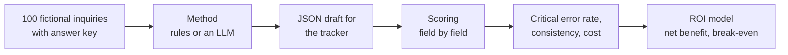

# Which LLM Should an Export Sales Team Use, and Is It Worth It?

**English** · [中文](README.zh-CN.md) · [Interactive ROI calculator](https://hql7-luo.github.io/llm-selection-roi/) · [Methodology](docs/methodology.md)

A small Chinese exporter of printing consumables and packaging gets about 500 inquiries a month by email, Alibaba and chat. Right now a salesperson reads each one, types the details into a tracker and decides which to answer first. The idea is to let an LLM draft the tracker entry (product, spec, quantity, target price, Incoterm, destination, delivery date, missing information, priority) and have the salesperson check it.

Two questions: **which model should the team use, and is it worth paying for?** To answer them I used 100 labeled inquiries, a scoring script, a no-AI baseline, five models tested on the same inquiries (three Claude, two GPT), list prices, public leaderboard scores and a simple ROI model. The company and every inquiry are fictional.

## The answer

**Pick the cheapest model that does well on your own inquiries. On this test set, that was Claude Haiku 5.5.** With the base-case assumptions, AI drafts pay off as long as fewer than about **17% of inquiries** have a critical error. All five models were well under that line. Simple rules without AI were not.

- **Most models made very few mistakes, but not all of them.** Each model answered the same 80 inquiries twice. Haiku and Opus made no critical errors. Sonnet made 1 in 160 (0.63%), GPT-6.1 Sol 2 in 160 (1.25%) and GPT-6 Luna 11 in 160 (6.88%). All of Sonnet's and Sol's errors were on one inquiry with a debatable answer (see below). The rules baseline had a critical error on 20% of inquiries, and on 55% of the hard ones.
- **It pays back quickly.** At 500 inquiries a month, Haiku comes out about **$714 a month** ahead after API, review and mistake costs, and pays back a $2,000 setup in about **2.8 months**. Sol: about $660 and 3.0 months. Luna: about $425 and 4.7 months. Rules alone lose about $125 a month.
- **A higher price did not mean fewer mistakes.** Luna and Haiku have the same list price, but Luna made 11 critical errors and Haiku none. Opus and Sol cost about 40 and 20 times as much as Haiku and did no better.
- **Mistakes cost far more than tokens.** API cost ranges from **$0.04 to $6.18 per 1,000 inquiries**, while an AI draft could save about **$728 of labor** per 1,000. Each point of critical error rate costs about **$42 a month**; the biggest price gap between models is about **$3 a month**.
- **Treat these scores as optimistic.** The inquiries are synthetic and were written with Claude's help, which may favor Claude. Public leaderboards measure general reasoning, not this task. Before choosing a model for real, test 50 to 100 real (anonymized) inquiries.

These are model estimates, not measured savings.


## Model results

All models got the same instructions and the same 80 test inquiries. Numbers come from [`results/method_summary.csv`](results/method_summary.csv).

| Method | Tested how | API cost per 1,000 (est.) | Critical errors | Fields correct | Same output both runs | Same score both runs | Public index (AA) |
|---|---|---:|---:|---:|---:|---:|---:|
| Rules baseline (no AI) | run locally | $0 | **20.00%** | 93.01% | (1 run) | (1 run) | |
| Claude Haiku 5.5 | Claude subagent, 2 runs | $0.15 | **0.00%** | 100.00% | 95.00% | 100.00% | 43 |
| Claude Sonnet 5.5 | Claude subagent, 2 runs | $3.09 | **0.63%** | 99.70% | 95.00% | 97.50% | 56 |
| Claude Opus 5.5 | Claude subagent, 2 runs | $6.18 | **0.00%** | 100.00% | 95.00% | 100.00% | 58 |
| GPT-6.1 Sol | Codex, 2 runs, medium | $3.09 | **1.25%** | 99.55% | 100.00% | 100.00% | 48 |
| GPT-6 Luna | Codex, 2 runs, medium | $0.15 | **6.88%** | 97.84% | 78.75% | 82.50% | 30 |
| DeepSeek V4.1 Flash | not tested | $0.42 | | | | | 45 |
| Qwen3.7 Flash | not tested | $0.04 | | | | | not listed |
| Qwen3.5 Plus | not tested | $0.68 | | | | | not listed |

"Same output" means both runs gave the same answer (spec wording can differ). "Same score" means both runs got the same fields right and wrong. Being consistent is not the same as being right: Sol gave the same answers both times, including the same mistake. Public index scores come from Artificial Analysis; the GPT rows use the medium reasoning setting they were tested at, and the Claude rows use the highest setting listed, so they are not directly comparable.


**How the models were tested.** No API key was used. Each model got the 80 test inquiries as 4 batches of 20, with the same instructions as the API prompt, and answered each batch in a fresh session that could open only that one batch file. Every model did this twice.

- Claude Haiku, Sonnet and Opus 5.5 ran as Claude subagents.
- GPT-6.1 Sol (the account's default) and GPT-6 Luna ran in fresh `codex exec` sessions outside this repository, at medium reasoning, in a read-only sandbox with web search off. All 16 batches came back in the right format on the first try; none were rerun or edited. Details are in `runs/codex__*/execution.json`.

Raw replies are kept in [`runs/`](runs). Since none of this went through an API, there are no token counts; costs are estimated from list prices, and actual Codex cost was not measured.

**Not tested yet:** DeepSeek and Qwen, and the GPT models through the API (`openai__` rows in the data files). The [API runner](#re-run-through-the-api) is ready for them.

**Where the models went wrong.**

- **One debatable inquiry (R55).** A Russian inquiry asks for "термальные пластины CTP" (thermal CTP plates) with no size or thickness. The answer key says there is no spec, because a plate cannot be quoted without size and thickness. Sonnet (once), Sol (both runs) and Luna (both runs) wrote "thermal" as the spec, which is a fair reading of the prompt. The key was set before any model ran and was not changed. Counting R55 as correct, Sonnet and Sol have no critical errors and Luna has 9 in 160 (5.6%).
- **Luna's other mistakes** were mostly ranking a good lead too low (7 times) and two wrong delivery dates. It never got a product, quantity or price wrong.

## Key charts

**Cost.** Even the most expensive model costs under 1% of the labor it could save.


**Where rules break.** Rules read tidy forms well. On the test set they failed on quantities written in words, in cans or as "25k", prices per 1,000 pieces, relative dates ("end of next month"), an older offer quoted below the reply, and company names that contain a product word or a city ("Minsk Label House").


**What moves the bar.** The review step, the cost of a mistake and the human error rate matter most. Model price matters least.


## How it works



- **Dataset:** 60 regular inquiries (Alibaba RFQ forms, short emails, chat messages, 8 in Russian), 25 hard ones written by hand, 15 traps (spam, phishing, fee scams, products we do not sell). 20 were used to build the prompt and rules; 80 were kept aside for testing.
- **Critical error:** a wrong product, spec, quantity, target price or delivery date, an invented item, or a high-priority lead ranked lower. I also track field accuracy, weighted error, invented values, a priority confusion matrix, JSON failures and run-to-run consistency.
- **ROI per inquiry:** labor saved, minus API cost, minus the extra cost of mistakes compared with a person doing it by hand (people make mistakes too). Monthly maintenance is included; the one-time setup cost sets the payback period.

Details: [methodology](docs/methodology.md).

## Data

| Input | Value | Source (date) |
|---|---|---|
| Claude Haiku / Sonnet / Opus 5.5 | $0.10 / $2 / $4 input, $0.50 / $10 / $20 output per million tokens | Anthropic pricing page (Oct 23, 2026) |
| GPT-6.1 Sol / GPT-6 Luna | $2 / $0.10 input, $10 / $0.50 output per million tokens | OpenAI API pricing page, standard rate (Oct 23, 2026) |
| DeepSeek V4.1 Flash, Qwen3.7 Flash, Qwen3.5 Plus | see [`data/pricing.csv`](data/pricing.csv) | BenchLM price tables citing the official pages; secondary source |
| Public leaderboard scores | see [`data/public_benchmarks.csv`](data/public_benchmarks.csv) | Artificial Analysis (Oct 23, 2026) |
| Foreign-trade salesperson salary, Hangzhou | ¥8,672 a month | Liepin, 4,443 postings over the past year (checked Oct 23, 2026) |
| USD/CNY | 6.6781 | Oct 22, 2026 |
| Handling time, review time, catch rate, error cost, volume | see [`data/roi_inputs.csv`](data/roi_inputs.csv) | Assumptions, labeled as such, with low and high values |

All sources with links: [docs/data-sources.md](docs/data-sources.md).

## Run it

```bash
pip install -r requirements.txt
python build_dataset.py      # rebuilds data/ (same output every time)
python run_eval.py rules     # no-AI baseline, free
python run_analysis.py       # scores every run, writes results/, figures/ and docs/roi-data.js
pytest                       # checks data, scoring, rules, runner, ROI and calculator parity
```

### Test a model without an API key

Make the batches outside the repo, answer each one in a fresh agent session, then import the replies. For example, with Codex:

```bash
python batches.py make ~/llm-batches/gpt-6.1-sol/run1
codex exec --cd ~/llm-batches/gpt-6.1-sol/run1 --model gpt-6.1-sol \
  --sandbox read-only --skip-git-repo-check --ignore-user-config --ephemeral \
  -c model_reasoning_effort=medium -c web_search=disabled --json \
  --output-last-message ~/llm-batches/gpt-6.1-sol/run1/reply1.txt \
  'Read batch1.txt in this folder and follow the instructions inside it. Answer every message yourself by reading it. Do not write or run any code, scripts or regex, and do not search the web. Do not open, list or search any other file or folder. Your final reply must be only the MODEL line followed by the ```jsonl block, exactly as batch1.txt asks.'
# repeat for batch2 to batch4 (new session each time, change both numbers)
python batches.py import codex__gpt-6.1-sol run1 ~/llm-batches/gpt-6.1-sol/run1 "Codex, batch of 20"
python run_analysis.py
```

Before importing, check that each reply has 20 lines starting with `{"id"`. Do a second pass in a `run2` folder for the consistency check. Keep the answering agent out of this repo so it cannot see `data/gold.jsonl`.

### Re-run through the API

To test a model the usual way (one inquiry per call, temperature 0, real token counts), set its key and run:

```bash
export DEEPSEEK_API_KEY=...             # or ANTHROPIC_API_KEY, OPENAI_API_KEY, DASHSCOPE_API_KEY
python run_eval.py deepseek:deepseek-flash --split dev --runs 1   # quick check on 20 inquiries
python run_eval.py deepseek:deepseek-flash --runs 3               # full run
python run_analysis.py
```

Testing all eight API models three times would cost about $3.32 at list prices (estimate). For a model not in [`data/pricing.csv`](data/pricing.csv), add a row first.

## Repository

```
data/          inquiries.jsonl, gold.jsonl (answer key), catalog, prices, public scores, ROI inputs, field weights
prompts/       extract_v1.txt (the instructions every model gets)
src/llmroi/    dataset and labels, rules baseline, API runner, batches, scoring, ROI model, charts
batches.py     make batch files for an agent and import its replies (no API key)
runs/          answers per method; runs/<method>/raw/ keeps the replies as received
results/       output tables (CSV)
figures/       charts used in this README
docs/          methodology, data sources, ROI calculator (index.html)
tests/         checks for data, scoring, rules, runner and ROI
```

## Limits

- **Synthetic data, written with Claude's help.** The inquiries are modeled on common printing-consumables export inquiries, but they are cleaner than a real inbox, and they may favor Claude. All scores are likely optimistic.
- **Small sample.** 80 test inquiries, two runs each. Running the same inquiry twice is not two independent examples, and zero errors here does not mean zero errors in real use.
- **No API runs.** All models answered 20 inquiries at a time inside an agent (Claude subagents, or Codex at medium reasoning), each with its own system prompt and settings. API results may differ, and costs are estimates.
- **Not every vendor is covered.** DeepSeek and Qwen are not tested yet. For a Chinese exporter, mainland access, data privacy and payment also matter; they are not scored here.
- **The rules baseline is probably optimistic too.** The same author wrote the rules and the data.
- **Labor and error-cost numbers are assumptions.** The most important ones (catch rate, cost of an escaped error, manual error rate) should be measured: time 10 inquiries by hand, and count how many AI errors reviewers catch in the first month.
- **Prices change.** DeepSeek and Qwen prices come from a secondary table; check the official pages before reuse.

## About

Independent project by Haoqi Luo (University of Washington, Foster School of Business). I chose the business question from my export sales experience and set the scope. Claude helped a lot with the research, data, code and writing, and Codex ran the GPT tests and helped update the docs. Not financial advice.
