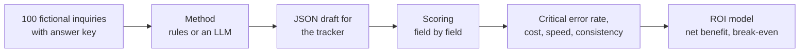

# Which LLM Should an Export Sales Team Use, and Is It Worth It?

**English** · [中文](README.zh-CN.md) · [Interactive ROI calculator](https://hql7-luo.github.io/llm-selection-roi/) · [Methodology](docs/methodology.md)

A small Chinese exporter of printing consumables and packaging gets about 500 inquiries a month by email, Alibaba and chat. Today a salesperson reads each one, types the details into a tracker and decides which to answer first. The idea: let an LLM draft the tracker entry (product, spec, quantity, target price, Incoterm, destination, delivery date, missing information, priority) and have the salesperson check it.

Two questions: **which model should the team use, and is it worth paying for at all?** This project answers with a labeled test set of 100 inquiries, a scoring script, a no-AI baseline that was actually run, current API prices and a simple ROI model. The company and every inquiry are fictional.

## The answer so far

**Choose the model by how accurate it is on your own inquiries, not by its price.** With the base-case assumptions, AI-assisted handling pays off when fewer than about **17% of inquiries** come back with a critical error. Simple rules without AI miss that bar (**20%** on the test set). The LLM tests themselves are still to run (see [Model results](#model-results)).

- **Model price barely matters.** At list prices the API costs **$0.04 to $6.18 per 1,000 inquiries** (estimated), while an AI draft could save about **$728 of labor** per 1,000. Going from the cheapest model to the most expensive moves the break-even point by **0.07 percentage points**.
- **Accuracy matters a lot.** At 500 inquiries a month, each percentage point of critical errors costs about **$42 a month** (fix time plus mistakes that reach customers). The whole price gap between the cheapest and the most expensive model is about **$3 a month**. A pricier model only needs to cut critical errors by about 0.1 points to be worth it.
- **Rules alone are not enough.** A keyword and regex baseline gets 93% of fields right, but 20% of test inquiries have at least one critical mistake (10% of tidy ones, 55% of hard ones). At 500 inquiries a month that is about **-$125 a month**.
- **The review step decides the most.** If reviewers catch 95% of AI errors instead of 80%, the acceptable error rate rises from 17% to 58%. If they catch only 60%, it falls to 9%.


## Model results

All methods use the same prompt and the same 80 test inquiries. Only the rules baseline has been run so far; this environment had no API keys. Testing all eight models three times costs about **$3.30** at list prices.

| Method | API cost per 1,000 inquiries | Critical error rate (test) | Status |
|---|---:|---:|---|
| Rules baseline (no AI) | $0 | **20.0%** | Measured |
| Qwen3.7 Flash | $0.04 (est.) | | Pending |
| Claude Haiku 5.5 | $0.15 (est.) | | Pending |
| GPT-6 Luna | $0.15 (est.) | | Pending |
| DeepSeek V4.1 Flash | $0.42 (est.) | | Pending |
| Qwen3.5 Plus | $0.68 (est.) | | Pending |
| Claude Sonnet 5.5 | $3.09 (est.) | | Pending |
| GPT-6.1 Sol | $3.09 (est.) | | Pending |
| Claude Opus 5.5 | $6.18 (est.) | | Pending |

To fill in a row, see [Add model results](#add-model-results). Charts, tables and the calculator update themselves.

## Key charts

**Cost.** Even the most expensive model costs under 1% of the labor it could save.


**Where rules break.** Rules read tidy forms well. On the test set they failed on quantities in words, cans or "25k", prices per 1,000 pieces, relative dates ("end of next month"), an older offer quoted below the reply, and company names that contain a product word or a city ("Minsk Label House").


**What moves the bar.** The review step, the cost of a mistake and the human error rate matter most. Model price is the smallest bar.


## How it works



- **Dataset:** 60 regular inquiries (Alibaba RFQ forms, short emails, chat messages, 8 in Russian), 25 hard ones written by hand, 15 traps (spam, phishing, fee scams, products we do not sell). 20 for building the prompt and rules, 80 locked for testing.
- **Critical error:** an inquiry with a wrong product, spec, quantity, target price or delivery date, an invented item, or a high-priority lead ranked lower. Also measured: field accuracy, weighted error, invented values, priority confusion matrix, JSON failures, run-to-run consistency, cost and speed.
- **ROI per inquiry:** labor saved minus API cost minus the extra cost of mistakes, compared with a person doing it by hand (people make mistakes too). Monthly maintenance is included; the one-time setup cost gives the payback period.

Details: [methodology](docs/methodology.md).

## Data

| Input | Value | Source (date) |
|---|---|---|
| Claude Haiku / Sonnet / Opus 5.5 | $0.10 / $2 / $4 input, $0.50 / $10 / $20 output per million tokens | Anthropic pricing page (Oct 23, 2026) |
| GPT-6 Luna, GPT-6.1 Sol, DeepSeek V4.1 Flash, Qwen3.7 Flash, Qwen3.5 Plus | see [`data/pricing.csv`](data/pricing.csv) | BenchLM price tables citing official pages (synced Oct 20, 2026); secondary source |
| Foreign-trade salesperson salary, Hangzhou | ¥8,672 a month | Liepin, 4,443 postings over the past year (checked Oct 23, 2026) |
| USD/CNY | 6.6781 | Oct 22, 2026 |
| Handling time, review time, catch rate, error cost, volume | see [`data/roi_inputs.csv`](data/roi_inputs.csv) | Assumptions, labeled as such, with low and high values |

All sources with links: [docs/data-sources.md](docs/data-sources.md).

## Run it

```bash
pip install -r requirements.txt
python build_dataset.py      # rebuilds data/ (same output every time)
python run_eval.py rules     # no-AI baseline, free
python run_analysis.py       # scores every run, writes results/, figures/ and docs/roi-data.js
pytest                       # 14 checks, including Python vs. JavaScript parity
```

### Add model results

```bash
export ANTHROPIC_API_KEY=...            # or OPENAI_API_KEY, DEEPSEEK_API_KEY, DASHSCOPE_API_KEY
python run_eval.py anthropic:claude-haiku-5-5 --split dev --runs 1   # quick check on 20 inquiries
python run_eval.py anthropic:claude-haiku-5-5 --runs 3               # full run, 3 times for consistency
python run_eval.py deepseek:deepseek-flash --runs 3
python run_eval.py qwen:qwen3.7-flash --runs 3                        # confirm the model ID in Model Studio
python run_analysis.py
```

Raw answers are saved to `runs/`, so scoring can be repeated without calling the API again. Costs then come from the token counts the API reports, not from the estimate. For a model that is not in [`data/pricing.csv`](data/pricing.csv), add a row first.

## Repository

```
data/          inquiries.jsonl, gold.jsonl (answer key), catalog, prices, ROI inputs, field weights
prompts/       extract_v1.txt (the one prompt every model gets)
src/llmroi/    dataset and labels, rules baseline, runner, scoring, ROI model, charts
runs/          raw answers per method (rules so far)
results/       output tables (CSV)
figures/       charts used in this README
docs/          methodology, data sources, ROI calculator (index.html)
tests/         checks for data, scoring, rules, runner and ROI
```

## Limits

- **No LLM has been tested yet.** The cost side and the break-even bar are real; whether a given model clears the bar is not known until the tests run.
- **The data is synthetic.** The inquiries and answer key were written for this project with AI help (Claude), modeled on common printing-consumables export inquiries. Claude models are also in the lineup, which could favor them. Before a real decision, label 50 to 100 real (anonymized) inquiries.
- **The rules baseline is probably optimistic.** The same author wrote the rules and the data. Real inboxes are messier.
- **Labor and error-cost numbers are assumptions.** The most important ones (catch rate, cost of an escaped error, manual error rate) should be measured: time 10 inquiries by hand, and track how many AI errors reviewers catch in the first month.
- **Prices change.** OpenAI, DeepSeek and Qwen prices come from a secondary price table; check the official pages. Token counts are estimated until a run replaces them. Models that "think" before answering can use many more output tokens; at 10 times the output, the most expensive model would move the break-even point from 17.0% to 16.6%.
- Data privacy, mainland China access and payment are real selection factors for a Chinese exporter but are not scored here.

## About

Independent project by Haoqi Luo (University of Washington, Foster School of Business). I chose the business question from my export sales experience and set the scope; AI tools (Claude) substantially assisted the research, data, code and writing. Not financial advice.
