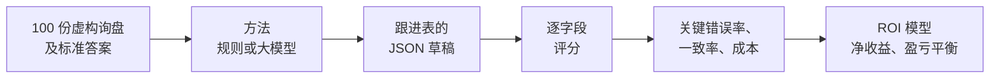

# 外贸业务团队该用哪个大模型？值不值得用？

[English](README.md) · **中文** · [交互式 ROI 计算器](https://hql7-luo.github.io/llm-selection-roi/) · [方法说明（英文）](docs/methodology.md)

一家做印刷耗材和包装出口的中国小公司，每月通过邮件、阿里巴巴和聊天工具收到约 500 封询盘。现在是业务员一封封看、手动登记到跟进表，再决定先回哪封。设想是：让大模型先生成登记草稿（产品、规格、数量、目标价、贸易条款、目的地、交期、缺失信息、优先级），业务员再核对。

两个问题：**该用哪个模型？值不值得花这笔钱？** 我用了 100 份带标准答案的询盘、一套评分代码、一个不用 AI 的规则基线、在同一批询盘上实测的 8 个模型（3 个 Claude、2 个 GPT、2 个 DeepSeek、1 个 Kimi）、当天的标价、公开榜单分数，加一个简单的 ROI 模型。公司和所有询盘都是虚构的。

## 结论

**选在你们自己询盘上表现好的、最便宜的那个模型。在这套测试里，是 Claude Haiku 5.5。** 在基准假设下，只要出现关键错误的询盘少于约 **17%**，用 AI 草稿就划算。8 个模型都在这条线以下，其中 Kimi K2.7 Code（11.88%）离线最近。不用 AI 的规则方法没过线。

- **大多数模型很少出错，但不是全部。** 每个模型把同一批 80 份询盘跑两遍。Haiku、Opus 和 DeepSeek V4 Pro 没有关键错误；Sonnet 160 次错 1 次（0.63%），GPT-6.1 Sol 和 DeepSeek V4.1 Flash 各错 2 次（1.25%），GPT-6 Luna 错 11 次（6.88%），Kimi K2.7 Code 错 19 次（11.88%）。Sonnet、Sol 和 V4.1 Flash 的错误全都出在同一封答案有争议的询盘上（见下文）。规则方法有 20% 的询盘出现关键错误，难题里是 55%。
- **DeepSeek 表现一样好，这对国内团队有用。** 如果公司更想用在国内能直接访问、方便付款的服务，DeepSeek V4 Pro（每千份约 $1.64）没有出错，V4.1 Flash（$0.42）只错在那封有争议的询盘上。这两个是在 WorkBuddy 里测的，正式选用前值得用 DeepSeek 自己的 API 再确认一次。
- **回本很快。** 每月 500 封询盘时，用 Haiku 扣掉 API、核对和出错成本后每月约多赚 **$714**，$2,000 的搭建成本约 **2.8 个月**收回。DeepSeek V4 Pro 差不多（$713）。Sol 和 V4.1 Flash 约 $660、3.0 个月，Luna 约 $425、4.7 个月，Kimi 约 $215、9.3 个月。只用规则每月约亏 $125。
- **价格高不代表错得少。** Luna 和 Haiku 标价一样，但 Luna 错了 11 次，Haiku 一次没错。Kimi 的价格约是 Haiku 的 9 倍，错得却最多。Opus 和 Sol 的价格分别约是 Haiku 的 40 倍和 20 倍，成绩并没有更好。
- **出错的代价远大于 token 费用。** 每千份询盘的 API 成本是 **$0.04 到 $6.18**，而 AI 草稿每千份能省约 **$728 人工**。关键错误率每高 1 个百分点，每月多花约 **$42**；模型之间最大的价差每月只有约 **$3**。
- **这些分数要往乐观方向打折。** 询盘是在 Claude 帮助下写的合成数据，可能偏向 Claude。公开榜单测的是通用推理，不是这个任务。真要选模型前，先拿 50 到 100 封真实（脱敏）询盘测一次。

以上是模型测算，不是实际节省下来的钱。


## 模型结果

所有模型拿到的是同一套指令、同一批 80 份测试询盘。数字来自 [`results/method_summary.csv`](results/method_summary.csv)。

| 方法 | 测试方式 | 每千份 API 成本（估算） | 关键错误率 | 字段正确率 | 两遍输出相同 | 两遍得分相同 | 公开榜单（AA） |
|---|---|---:|---:|---:|---:|---:|---:|
| 规则基线（不用 AI） | 本地运行 | $0 | **20.00%** | 93.01% | （1 遍） | （1 遍） | |
| Claude Haiku 5.5 | Claude 子代理，2 遍 | $0.15 | **0.00%** | 100.00% | 95.00% | 100.00% | 43 |
| Claude Sonnet 5.5 | Claude 子代理，2 遍 | $3.09 | **0.63%** | 99.70% | 95.00% | 97.50% | 56 |
| Claude Opus 5.5 | Claude 子代理，2 遍 | $6.18 | **0.00%** | 100.00% | 95.00% | 100.00% | 58 |
| GPT-6.1 Sol | Codex，2 遍，medium | $3.09 | **1.25%** | 99.55% | 100.00% | 100.00% | 48 |
| GPT-6 Luna | Codex，2 遍，medium | $0.15 | **6.88%** | 97.84% | 78.75% | 82.50% | 30 |
| DeepSeek V4 Pro | WorkBuddy，2 遍 | $1.64 | **0.00%** | 100.00% | 90.00% | 100.00% | 36 |
| DeepSeek V4.1 Flash | WorkBuddy，2 遍 | $0.42 | **1.25%** | 99.48% | 93.75% | 98.75% | 45 |
| Kimi K2.7 Code | WorkBuddy，2 遍 | $1.35 | **11.88%** | 97.77% | 66.25% | 87.50% | 26 |
| Qwen3.7 Flash | 未测试 | $0.04 | | | | | 未收录 |
| Qwen3.5 Plus | 未测试 | $0.68 | | | | | 未收录 |

"输出相同"指两遍给出的答案一样（规格的写法可以不同）；"得分相同"指两遍对错的字段完全一样。稳定不等于正确：Sol 两遍答案完全一样，连错误也一样。Kimi 两遍之间约三分之一的询盘答案不一样。公开榜单分数来自 Artificial Analysis；GPT 用的是测试时的 medium 推理档，Claude 和 DeepSeek 用的是列出的最高档，所以不能直接比较。


**怎么测的。** 没有用 API key。每个模型拿到的 80 份测试询盘分成 4 批、每批 20 份，指令和 API 版相同。每一批都在一个新会话里作答，这个会话只能看到这一批。每个模型跑两遍。

- Claude Haiku、Sonnet、Opus 5.5 以 Claude 子代理的方式运行。
- GPT-6.1 Sol（账号默认模型）和 GPT-6 Luna 在仓库外的全新 `codex exec` 会话里运行：medium 推理档、只读沙盒、关闭联网搜索。16 批第一次就全部格式合格，没有重跑，也没有改动回答。细节见 `runs/codex__*/execution.json`。
- DeepSeek V4 Pro、DeepSeek V4.1 Flash 和 Kimi K2.7 Code 用 WorkBuddy（腾讯的 AI 智能体应用）内置的模型运行。每个模型单独开一个聊天，在界面里手动选定模型；这个聊天里的调度会话把每一批的全文贴给一个全新的子代理，子代理不能读任何文件。应用不显示实际作答的是哪个模型，所以模型身份只能靠界面上的选择来认；每份回复自报的都是对应的模型。Kimi 有一批因为第一次回复里有重复的 JSON 字段，重跑了一次。细节见 `runs/workbuddy__*/execution.json`。

原始回答保存在 [`runs/`](runs)。因为都没有走 API，所以没有 token 数；成本按标价估算，Codex 和 WorkBuddy 的实际成本都没有测。

**还没测的：** Qwen，以及通过 API 调用的 GPT 和 DeepSeek（数据文件里的 `openai__` 和 `deepseek__` 行）。[API runner](#通过-api-重跑) 已经准备好。

**模型错在哪里。**

- **一封有争议的询盘（R55）。** 这封俄语询盘要"термальные пластины CTP"（热敏 CTP 版），但没给尺寸和厚度。标准答案是"没有规格"，因为没有尺寸和厚度就没法报价。Sonnet（1 次）、Sol、Luna 和 DeepSeek V4.1 Flash（各两遍）以及 Kimi（1 次）把"thermal"填成了规格，按提示词的写法这也说得通。标准答案是在任何模型运行之前定的，之后没有改。如果把 R55 算对，Sonnet、Sol 和 V4.1 Flash 都没有关键错误，Luna 是 160 次错 9 次（5.6%），Kimi 是 18 次（11.25%）。
- **把好询盘排低了。** 其余错误大多是这一种：Kimi 19 次里占 17 次，Luna 11 次里占 7 次。Kimi 这些错误都是因为贸易条款、目的地或交期缺了一项，就标成了"medium"；但规则只要求有规格、数量不低于起订量，再加上贸易条款或目的地其中之一。既然优先级是按固定规则算的，一个值得试的改法是让代码根据提取出的字段来算优先级，不交给模型。
- **其他错误：** Luna 有 2 次交期写错，Kimi 有 1 次把样品询盘当成了不是真实询盘。两个模型都没有把目标价写错。

## 主要图表

**成本。** 最贵的模型，成本也不到它能省下人工的 1%。


**规则在哪里出错。** 规整的表单读得很好。在测试集上，它在这些地方出错：数量用文字、"桶"或"25k"表示，按每千个报价，相对日期（"下个月底"），邮件下面引用的旧报价，以及公司名里带产品词或城市名（"Minsk Label House"）。


**什么会改变结论。** 人工核对能发现多少错误、一次错误的代价、人工本身的错误率影响最大。模型价格影响最小。


## 怎么做的



- **数据集：** 60 份常规询盘（阿里巴巴 RFQ 表单、短邮件、聊天消息，其中 8 份俄语），25 份手写难题，15 份陷阱（垃圾邮件、钓鱼、收费诈骗、我们不卖的产品）。20 份用来调提示词和规则，80 份留作测试。
- **关键错误：** 产品、规格、数量、目标价或交期有错，凭空多出一个产品，或者把高优先级询盘排低了。另外还统计字段准确率、加权错误、编造信息的比例、优先级混淆矩阵、JSON 格式失败率和两遍结果的一致率。
- **每封询盘的 ROI：** 省下的人工，减去 API 成本，再减去比纯人工多出来的错误损失（人也会出错）。月度结果包含每月维护费；一次性搭建成本用来算回本时间。

详细说明见 [methodology（英文）](docs/methodology.md)。

## 数据

| 输入 | 数值 | 来源（日期） |
|---|---|---|
| Claude Haiku / Sonnet / Opus 5.5 | 每百万 token 输入 $0.10 / $2 / $4，输出 $0.50 / $10 / $20 | Anthropic 官方价格页（2026-10-23） |
| GPT-6.1 Sol / GPT-6 Luna | 每百万 token 输入 $2 / $0.10，输出 $10 / $0.50 | OpenAI 官方 API 价格页，标准价（2026-10-23） |
| DeepSeek V4 Pro / V4.1 Flash | 每百万 token 输入 $1.32 / $0.30，输出 $3.96 / $1.20（高峰价，闲时半价） | BenchLM 价格汇总，引用 DeepSeek 官方价格页；二手来源 |
| Kimi K2.7 Code | 每百万 token 输入 $0.95，输出 $4.00 | eesel.ai 文章，引用 Moonshot 官方价格页；二手来源 |
| Qwen3.7 Flash、Qwen3.5 Plus | 见 [`data/pricing.csv`](data/pricing.csv) | BenchLM 价格汇总，引用阿里云百炼；二手来源 |
| 公开榜单分数 | 见 [`data/public_benchmarks.csv`](data/public_benchmarks.csv) | Artificial Analysis（2026-10-23） |
| 外贸业务员月薪（杭州） | ¥8,672 | 猎聘，近一年 4,443 个职位样本（2026-10-23 查询） |
| 美元兑人民币 | 6.6781 | 2026-10-22 |
| 人工处理时间、核对时间、错误发现率、错误损失、询盘量 | 见 [`data/roi_inputs.csv`](data/roi_inputs.csv) | 假设值，均已标注，并给出高低范围 |

所有来源链接：[docs/data-sources.md（英文）](docs/data-sources.md)。

## 运行

```bash
pip install -r requirements.txt
python build_dataset.py      # 重新生成 data/（每次结果相同）
python run_eval.py rules     # 规则基线，不花钱
python run_analysis.py       # 给所有结果打分，生成 results/、figures/ 和 docs/roi-data.js
pytest                       # 检查数据、评分、规则、runner、ROI，以及 Python 和网页结果一致
```

### 不用 API key 测其他模型

在仓库外生成批次，每批用一个新的代理会话作答，再把回复导入。以 Codex 为例：

```bash
python batches.py make ~/llm-batches/gpt-6.1-sol/run1
codex exec --cd ~/llm-batches/gpt-6.1-sol/run1 --model gpt-6.1-sol \
  --sandbox read-only --skip-git-repo-check --ignore-user-config --ephemeral \
  -c model_reasoning_effort=medium -c web_search=disabled --json \
  --output-last-message ~/llm-batches/gpt-6.1-sol/run1/reply1.txt \
  'Read batch1.txt in this folder and follow the instructions inside it. Answer every message yourself by reading it. Do not write or run any code, scripts or regex, and do not search the web. Do not open, list or search any other file or folder. Your final reply must be only the MODEL line followed by the ```jsonl block, exactly as batch1.txt asks.'
# 第 2 到 4 批照做（每次都开新会话，两个文件编号一起改）
python batches.py import codex__gpt-6.1-sol run1 ~/llm-batches/gpt-6.1-sol/run1 "Codex, batch of 20"
python run_analysis.py
```

WorkBuddy 也可以：在新聊天里手动选好模型，让这个聊天把每一批贴给一个全新的子代理（见 `runs/workbuddy__*/execution.json`）。导入前检查每份回复都有 20 行以 `{"id"` 开头的 JSON。再在 `run2` 文件夹里跑第二遍，才有一致性检查。作答的代理不要进入本仓库，免得看到 `data/gold.jsonl`。

### 通过 API 重跑

想用常规方式测某个模型（每次一封询盘、temperature 0、有真实 token 数），设置 key 后运行：

```bash
export DEEPSEEK_API_KEY=...             # 或 ANTHROPIC_API_KEY、OPENAI_API_KEY、DASHSCOPE_API_KEY
python run_eval.py deepseek:deepseek-flash --split dev --runs 1   # 先用 20 份试一下
python run_eval.py deepseek:deepseek-flash --runs 3               # 正式跑
python run_analysis.py
```

按标价估算，10 个 API 模型各跑 3 遍约 $4.03。如果模型不在 [`data/pricing.csv`](data/pricing.csv) 里，先加一行价格。

## 仓库目录

```
data/          询盘、标准答案、产品目录、价格、公开分数、ROI 输入、字段权重
prompts/       extract_v1.txt（各模型共用的指令）
src/llmroi/    数据集、规则基线、API runner、批次、评分、ROI 和图表
batches.py     为代理生成批次并导入回复，不需要 API key
runs/          各方法的回答；raw/ 保留原始回复
results/       分析结果表（CSV）
figures/       README 图表
docs/          方法、数据来源、ROI 计算器
tests/         数据、评分、规则、runner 和 ROI 检查
```

## 局限

- **合成数据，而且有 Claude 参与编写。** 询盘参照常见的印刷耗材外贸询盘，但比真实邮箱干净，也可能偏向 Claude。所有分数大概率偏乐观。
- **样本小。** 80 份测试询盘，每个模型跑两遍。同一封询盘跑两遍不算两个独立样本，这里零错误不代表实际使用中零错误。
- **都不是 API 测试。** 所有模型都是在代理里一次处理 20 份（Claude 子代理、Codex 的 medium 推理档，或 WorkBuddy 子代理），各有自己的系统提示和设置。走 API 的结果可能不同，成本也是估算。
- **WorkBuddy 里的模型无法核实。** 模型是在界面上选的，推理设置用的是应用默认值。DeepSeek 9 月还说过 V4 Pro 的 API 请求会转给 V4.1 Flash，但它的价格页上仍然列着 V4 Pro。这两个模型在这里的回答确实不一样，但我没法确认 WorkBuddy 实际用的是哪个。
- **没有覆盖所有厂商。** Qwen 还没测。Kimi 的 K2 系列 2026 年 10 月 31 日后不再接受新注册。对中国出口企业来说，国内能否访问、数据隐私和付款方式也很重要，这里没有打分。
- **规则基线的成绩也可能偏乐观。** 规则和数据是同一个作者写的。
- **人工和错误损失是假设值。** 最关键的几项（核对发现率、错误流出去的损失、人工错误率）应该实测：手动计时处理 10 封询盘，第一个月统计核对时发现了多少 AI 错误。
- **价格会变。** DeepSeek、Kimi 和 Qwen 的价格来自二手来源，再用之前请看官方页面。

## 关于

罗浩绮（Haoqi Luo，华盛顿大学 Foster 商学院）的独立项目。我根据自己的外贸工作经历选了这个问题并确定范围。Claude 在调研、数据、代码和写作上帮了很多忙，Codex 跑了 GPT 的测试并协助更新文档，WorkBuddy 跑了 DeepSeek 和 Kimi 的测试。不构成财务建议。
