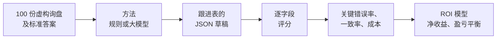

# 外贸业务团队该用哪个大模型？值不值得用？

[English](README.md) · **中文** · [交互式 ROI 计算器](https://hql7-luo.github.io/llm-selection-roi/) · [方法说明（英文）](docs/methodology.md)

一家做印刷耗材和包装出口的中国小公司，每月通过邮件、阿里巴巴和聊天工具收到约 500 封询盘。现在是业务员一封封看、手动登记到跟进表，再决定先回哪封。设想是：让大模型先生成登记草稿（产品、规格、数量、目标价、贸易条款、目的地、交期、缺失信息、优先级），业务员再核对。

两个问题：**该用哪个模型？到底值不值得花这笔钱？** 项目用 100 份带标准答案的询盘、一套评分代码、一个不用 AI 的规则基线、三个测过的 Claude 模型、两个通过 Codex 测过的 GPT 模型、API 参考价格、公开榜单分数，加一个简单的 ROI 模型来回答。公司和所有询盘都是虚构的。

## 结论

**在这套数据里，Claude Haiku 5.5 的 API 参考价格较低，而且没有观察到关键错误。选用前还需要用你们自己的询盘验证。** 在基准假设下，"AI 草稿 + 人工核对"的盈亏平衡点约为 **17% 关键错误率**。五个测过的模型都低于这条线，规则基线高于这条线。这是模型测算，并非实测业务收益。

- **各模型的错误不同。** 每个模型把同一批 80 份询盘跑了两遍。Haiku 和 Opus 没有关键错误；Sonnet 是 **1/160（0.63%）**，GPT-6.1 Sol 是 **2/160（1.25%）**，GPT-6 Luna 是 **11/160（6.88%）**。规则方法有 **20%** 的询盘出现关键错误，难题里是 **55%**。Sol 标准化后的输出在两遍完全一致，但其中也包含重复的错误。一致不等于正确。
- **ROI 取决于假设。** 每月 500 封询盘时，Haiku 的测算净收益约为每月 **$714**，约 **2.8 个月**收回搭建成本。Sol 对应约为 **$660、3.0 个月**，Luna 约为 **$425、4.7 个月**。只用规则的测算结果是每月约亏 **$125**。
- **在这套 ROI 模型里，错误成本比 token 价格影响更大。** API 参考成本估算为每千份 **$0.04 到 $6.18**，相应的潜在人工节省约为 **$728**。关键错误率每高 1 个百分点，每月多花约 **$42**；最大的模型价差每月约 **$3**。Luna 和 Haiku 的参考 token 价格相同，但这里的错误更多。Opus 比 Haiku 贵，得分并没有更高；Sol 也更贵，而且出现了错误。价格更高不保证准确率更高。
- **公开榜单和合成测试都只能提供有限证据。** Artificial Analysis 是综合推理指数，不是询盘抽取测试。下表 GPT 用 medium 推理档，保留的 Claude 分数用其最高列出档位。询盘和标准答案是在 Claude 帮助下写的，可能偏向 Claude。采用模型前，需要用真实脱敏询盘确认结果。


## 模型结果

已测方法使用同一批 80 份测试询盘和相同的抽取指令，但代理系统提示和运行设置不同。下列数值来自 [`results/method_summary.csv`](results/method_summary.csv)。

| 方法 | 测试方式 | 每千份 API 参考成本 | 关键错误率 | 字段正确率 | 输出一致率 | 评分一致率 | 公开榜单（AA） |
|---|---|---:|---:|---:|---:|---:|---:|
| 规则基线（不用 AI） | 本地运行 | $0 | **20.00%** | 93.01% | （1 遍） | （1 遍） | |
| Claude Haiku 5.5 | Claude 子代理，2 遍 | $0.15（估算） | **0.00%** | 100.00% | 95.00% | 100.00% | 43 |
| Claude Sonnet 5.5 | Claude 子代理，2 遍 | $3.09（估算） | **0.63%** | 99.70% | 95.00% | 97.50% | 56 |
| Claude Opus 5.5 | Claude 子代理，2 遍 | $6.18（估算） | **0.00%** | 100.00% | 95.00% | 100.00% | 58 |
| GPT-6.1 Sol | Codex，2 遍，medium | $3.09（估算） | **1.25%** | 99.55% | 100.00% | 100.00% | 48 |
| GPT-6 Luna | Codex，2 遍，medium | $0.15（估算） | **6.88%** | 97.84% | 78.75% | 82.50% | 30 |
| DeepSeek V4.1 Flash | 未测试 | $0.42（估算） | | | | | 45 |
| Qwen3.7 Flash | 未测试 | $0.04（估算） | | | | | 未收录 |
| Qwen3.5 Plus | 未测试 | $0.68（估算） | | | | | 未收录 |

**一致率的定义。** 输出一致率比较两遍标准化后的抽取结果，不包含优先级解释。评分一致率比较各字段相对于标准答案的对错模式。不同回答也可能得到同样的评分。百分比按汇总文件四舍五入，上文的错误次数给出了确切分母。

GPT 结果的方法名是 `codex__gpt-6.1-sol` 和 `codex__gpt-6-luna`。单独的 `openai__` 方法仍等待 API 测试，没有在表中重复列出，其旧的 max 档公开分数仍保留在来源数据中。Codex 行使用 AA Intelligence Index v4.3.2 的 medium 推理档，因此表中公开分数的推理设置并不相同。


**Claude 模型怎么测的。** 没有用 API key。三个模型在构建环境里以 Claude 子代理的方式运行：每个子代理拿到一批 20 份询盘和与 API 版相同的指令，只允许打开这一个批次文件（每个都只读了一次文件），每份询盘回一行 JSON。每个模型把 80 份测试询盘跑两遍。原始回答保存在 [`runs/`](runs)。因为没有调用 API，所以没有 token 数和响应时间，成本按标价估算。

**GPT 模型怎么测的。** 没有用 API key。账号配置的默认模型 GPT-6.1 Sol，以及较小的 GPT-6 Luna，分别在仓库外通过全新的 `codex exec` 实例、以 medium 推理档运行。每个模型跑两遍，每遍四批，每批 20 份。每个实例都使用只读沙盒，只读取自己的批次文件，由命令行输出选项保存最终回复。16 批都在首次格式检查时合格，每批 20 条 JSON；没有重跑或修改回答，16 个实例的 thread ID 各不相同。这是 Codex 结果，不是 API 结果，Codex 成本没有实测。表中使用估算 token 用量和官方 API 参考价格。

**哪些还没测。** DeepSeek 和 Qwen 没有测试，`openai__` API 方法也仍等待测试；这里的 GPT 实测对应单独的 Codex 方法。可用 [API runner](#通过-api-重跑) 获取 API 结果和实际 token 用量。

**Claude 的错误。** 有一封俄语询盘写的是“термальные пластины CTP”（热敏 CTP 版），但没给尺寸和厚度。Sonnet 有一次把“thermal”填成了规格。标准答案是“没有规格”，因为没有尺寸和厚度就没法报价；不过 Sonnet 的理解也说得通。第二遍时它和标准答案一致。

## 主要图表

**成本。** 最高的 API 参考成本估算不到测算人工节省的 1%。这不代表 Codex 的实际账单。


**规则在哪里出错。** 规整的表单读得很好。在测试集上，它在这些地方出错：数量用文字、“桶”或“25k”表示，按每千个报价，相对日期（“下个月底”），邮件下面引用的旧报价，以及公司名里带产品词或城市名（“Minsk Label House”）。


**什么会改变结论。** 人工核对能发现多少错误、一次错误的代价、人工本身的错误率影响最大。模型价格是最小的那一项。


## 怎么做的



- **数据集：** 60 份常规询盘（阿里巴巴 RFQ 表单、短邮件、聊天消息，其中 8 份俄语），25 份手写难题，15 份陷阱（垃圾邮件、钓鱼、收费诈骗、我们不卖的产品）。20 份用来调提示词和规则，80 份锁定只做最终测试。
- **关键错误：** 产品、规格、数量、目标价或交期有错，凭空多出一个产品，或者把高优先级询盘排低了。另外还统计字段准确率、加权错误、编造信息的比例、优先级混淆矩阵、JSON 格式失败率和两遍结果的一致率。
- **每封询盘的 ROI：** 省下的人工，减去 API 成本，再减去比纯人工多出来的错误损失（人也会出错）。月度结果包含每月维护费；一次性搭建成本用来算回本时间。

详细说明见 [methodology（英文）](docs/methodology.md)。

## 数据

| 输入 | 数值 | 来源（日期） |
|---|---|---|
| Claude Haiku / Sonnet / Opus 5.5 | 每百万 token 输入 $0.10 / $2 / $4，输出 $0.50 / $10 / $20 | Anthropic 官方价格页（2026-10-23） |
| GPT-6.1 Sol / GPT-6 Luna（`codex__`） | 每百万 token 输入 $2 / $0.10，输出 $10 / $0.50 | OpenAI 官方 API 价格（2026-10-23），Standard、输入不超过 272K token；Codex 成本未实测 |
| 等待测试的 `openai__` API 方法、DeepSeek V4.1 Flash、Qwen3.7 Flash、Qwen3.5 Plus | 见 [`data/pricing.csv`](data/pricing.csv) | 保留原 BenchLM 价格汇总，引用各家官方页面，属于二手参考 |
| 公开榜单分数 | 见 [`data/public_benchmarks.csv`](data/public_benchmarks.csv) | Artificial Analysis（2026-10-23）；Codex 行用 medium、v4.3.2，其他行保留最高列出档位 |
| 外贸业务员月薪（杭州） | ¥8,672 | 猎聘，近一年 4,443 个职位样本（2026-10-23 查询） |
| 美元兑人民币 | 6.6781 | 2026-10-22 |
| 人工处理时间、核对时间、错误发现率、错误损失、询盘量 | 见 [`data/roi_inputs.csv`](data/roi_inputs.csv) | 假设值，均已标注，并给出高低范围 |

所有来源链接：[docs/data-sources.md（英文）](docs/data-sources.md)。

## 运行

```bash
pip install -r requirements.txt
python build_dataset.py      # 重新生成 data/（每次结果相同）
python run_eval.py rules     # 规则基线，不花钱
python run_analysis.py       # 给所有结果打分，生成 results/、figures/ 和 docs/roi-data.js
pytest                       # 检查数据、评分、规则、runner、ROI，以及 Python 和网页结果一致
```

### 不用 API key 测其他模型

先在仓库外生成批次，再为每一批启动全新代理。Claude 和 Codex 结果使用相同的批次格式：

```bash
python batches.py make ~/llm-batches/gpt-6.1-sol/run1
codex exec --cd ~/llm-batches/gpt-6.1-sol/run1 --model gpt-6.1-sol \
  --sandbox read-only --skip-git-repo-check --ignore-user-config --ephemeral \
  -c model_reasoning_effort=medium -c web_search=disabled --json \
  --output-last-message ~/llm-batches/gpt-6.1-sol/run1/reply1.txt \
  'Read batch1.txt in this folder and follow the instructions inside it. Answer every message yourself by reading it. Do not write or run any code, scripts or regex, and do not search the web. Do not open, list or search any other file or folder. Your final reply must be only the MODEL line followed by the ```jsonl block, exactly as batch1.txt asks.'
# 为第 2 至 4 批分别启动全新 exec，完成并检查四份回复后再导入。
python batches.py import codex__gpt-6.1-sol run1 ~/llm-batches/gpt-6.1-sol/run1 "Codex, batch of 20"
python run_analysis.py
```

第 2 至 4 批都要使用全新的 `codex exec`，同时修改两个文件编号。导入前检查每份回复都有 20 行以 `{"id"` 开头的 JSON。另建 `run2` 文件夹完成第二遍，并以 `run2` 导入。对 `gpt-6-luna` 重复同样流程。作答代理不要进入本仓库，免得看到 `data/gold.jsonl`。

### 通过 API 重跑

想用正常方式测某个模型（每次一封询盘、temperature 0、有真实 token 数），设置 key 后运行：

```bash
export DEEPSEEK_API_KEY=...             # 或 ANTHROPIC_API_KEY、OPENAI_API_KEY、DASHSCOPE_API_KEY
python run_eval.py deepseek:deepseek-flash --split dev --runs 1   # 先用 20 份试一下
python run_eval.py deepseek:deepseek-flash --runs 3               # 正式跑
python run_analysis.py
```

按标价估算，8 个 API 模型各跑 3 遍的预算约为 $3.32，来自 [`results/headline.csv`](results/headline.csv)，并非实测支出。如果模型不在 [`data/pricing.csv`](data/pricing.csv) 里，先加一行价格。用 API 重跑 Claude 模型会替换掉子代理结果；`openai__` 和 `codex__` 方法相互独立。

## 仓库目录

```
data/          询盘、标准答案、产品目录、价格、公开分数、ROI 输入、字段权重
prompts/       extract_v1.txt（各模型共用的指令）
src/llmroi/    数据集、规则基线、API runner、代理批次、评分、ROI 和图表
batches.py     为代理生成批次并导入回复，不需要 API key
runs/          各方法回答；raw/ 保留原始代理回复
results/       分析结果表（CSV）
figures/       README 图表
docs/          方法、数据来源、ROI 计算器
tests/         数据、评分、规则、runner 和 ROI 检查
```

## 局限

- **数据是合成的，而且有 Claude 参与编写。** 询盘和标准答案是在 Claude 帮助下为这个项目写的，参照常见的印刷耗材外贸询盘。这可能偏向 Claude，所有模型的成绩相对于真实邮箱都可能偏乐观。
- **样本较小。** 只有 80 份测试询盘，每个模型跑两遍。重复同一批询盘不等于获得 160 个独立样本。没有观察到关键错误，不代表生产中的错误率为零。
- **Claude 和 Codex 的测试都不是 API 测试。** 代理每次处理 20 份。Claude 使用代理默认设置，两个 GPT 模型在 Codex 中使用 medium 推理档。代理系统提示、工具和运行设置不同，API 结果也可能不同。token 用量和 API 参考成本均为估算，Codex 成本没有实测。
- **覆盖仍不完整。** 已测试两家厂商，但 DeepSeek、Qwen 和单独的 OpenAI API 方法仍等待测试。公开榜单的推理设置不同。对中国出口企业来说，国内能否访问、数据隐私和付款方式也很重要，这里没有打分。
- **规则基线的成绩可能偏乐观。** 规则和数据是同一个作者写的，真实邮箱会更乱。
- **人工和错误损失是假设值。** 最关键的几项（核对发现率、错误流出去的损失、人工错误率）应该实测：手动计时处理 10 封询盘，第一个月统计核对时发现了多少 AI 错误。
- **价格会变。** 新 Codex 行以核实过的 OpenAI 官方 API 价格作为参考。历史 `openai__` 行和 DeepSeek、Qwen 行保留二手来源。再次使用前应重新核实价格。

## 关于

罗浩绮（Haoqi Luo，华盛顿大学 Foster 商学院）的独立项目。我根据自己的外贸工作经历选了这个问题并确定范围；Claude 在调研、数据、代码和写作上提供了大量帮助，Codex 也协助了本次评测和文档更新。不构成财务建议。
